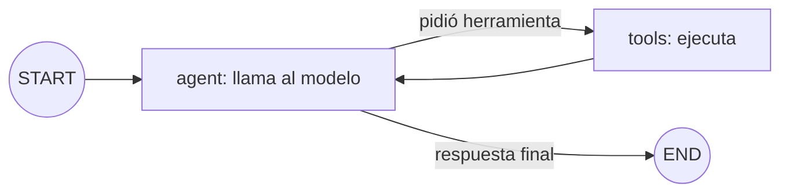

# A8 · LangGraph sobre un modelo de Microsoft Foundry

**Estado:** validado offline (langgraph 1.2.22, langchain-azure-ai 1.2.3): el grafo compila con los nodos `agent` y `tools`, y las herramientas se invocan correctamente. **Ejecución real: pendiente.**

## Idea clave
El grafo es explícito: estado → nodos → aristas.

Ver el flujo explícito ayuda a razonar sobre **límites de pasos** (control de consumo, OWASP LLM06): un bucle agente↔herramientas sin tope es un riesgo de costo.

## Ejecución
```bash
cd cloud-agents/azure/langgraph_agent
python3.12 -m venv .venv && . .venv/bin/activate
pip install -r requirements.txt && cp .env.example .env
az login && python agent_langgraph.py
```

## Pruebas offline / Seguridad / Costos / Limpieza
`pytest -q test_smoke.py`. Entra ID (`DefaultAzureCredential`). Costos: tokens. Sin recursos persistentes.

## Problemas
`ImportError` de `langchain_azure_ai`: instale desde `requirements.txt` en un entorno limpio.

## Reflexión
¿Cómo impondría un máximo de iteraciones (`recursion_limit`) y qué debería ocurrir cuando se alcanza?
