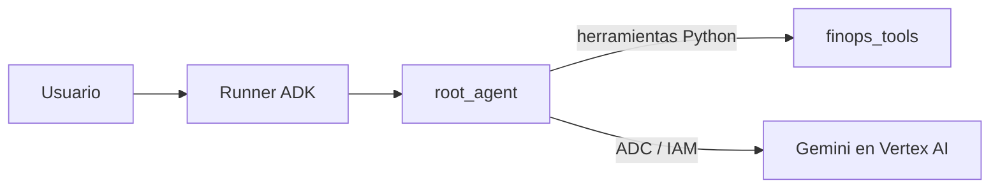

# A2 · Agente con Google Agent Development Kit (ADK)

**Estado:** validado offline (2 pruebas: el agente se construye y la herramienta se ejecuta con ADK 2.14.1). **Ejecución real contra Vertex AI: pendiente.**

## Objetivo
Definir un agente en Python con ADK, ejecutarlo localmente y conocer las rutas de despliegue (Agent Engine, Cloud Run).

## Arquitectura


## Prerrequisitos
Proyecto Google Cloud con Vertex AI habilitada; `gcloud` instalado; Python 3.12.

## Configuración
```bash
cd cloud-agents/gcp/adk_agent
python3.12 -m venv .venv && . .venv/bin/activate
pip install -r requirements.txt
gcloud auth application-default login
cp finops_agent/.env.example finops_agent/.env     # edite proyecto, región y modelo
```

## Ejecución
```bash
adk web                      # interfaz de desarrollo en el navegador (solo desarrollo, no producción)
python run_local.py "Estima el costo mensual de 200000 solicitudes con 800 tokens de entrada y 300 de salida a 1 y 4 USD por millón."
```
Resultado esperado: una respuesta que cita **400 USD/mes** (160 de entrada + 240 de salida) tomados de la herramienta, no «calculados de memoria» por el modelo.

## Prueba offline
`pip install pytest && pytest -q test_smoke.py`

## Despliegue (no ejecutado en este material)
`adk deploy agent_engine` (opciones `--project`, `--region`, `--display_name`, `--service_account`) o `adk deploy cloud_run`. Ejecute `adk deploy --help` para ver las opciones de su versión. Despliegue con una **cuenta de servicio de mínimo privilegio**.

## Seguridad
Sin API keys: ADC/IAM. `adk web` no debe exponerse a Internet. Las herramientas son de solo cálculo.

## Costos
Gemini se factura por token; el despliegue en Agent Engine/Cloud Run agrega costos de cómputo. **Verifique tarifas vigentes** y configure una alerta de Billing.

## Problemas frecuentes
- `Model not found / 404`: el ID de `GEMINI_MODEL` no existe en su región → copie uno de Model Garden.
- `Permission denied`: falta rol *Vertex AI User* o la API no está habilitada.
- Con ADK 1.x la variable era `GOOGLE_GENAI_USE_VERTEXAI=TRUE`; en 2.x el scaffold usa `GOOGLE_GENAI_USE_ENTERPRISE=1`.

## Limpieza
Elimine los despliegues desde la consola (Agent Engine / Cloud Run) y revise Billing al día siguiente.

## Reflexión
¿Qué ventaja tiene que ADK derive el esquema de la herramienta de la firma y el docstring? ¿Qué riesgo trae (pista: docstrings ambiguos)?
