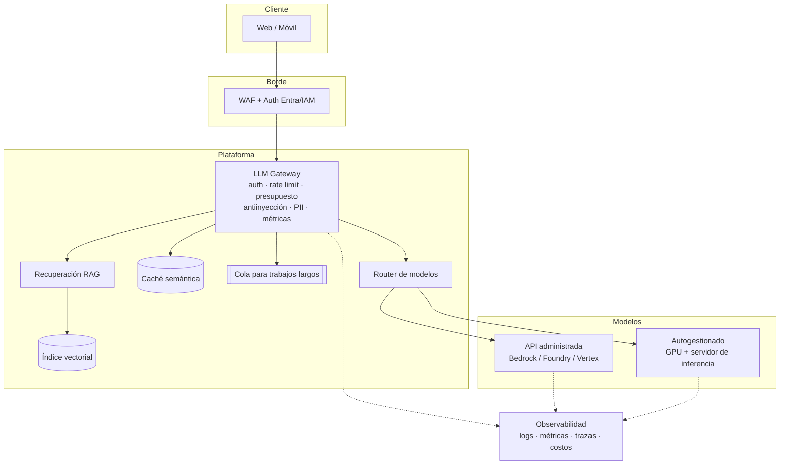

# Arquitecturas base y patrones de diseño para LLM en la nube

> Hechos documentados vs. recomendaciones: las secciones «Decisión» son recomendaciones de este curso para el caso universitario, no normas.

## 1. Requisitos del caso transversal
| Tipo | Requisito |
|---|---|
| Funcional | Responder preguntas con la normativa y documentos de la universidad; citar fuentes. |
| No funcional | 5.000 usuarios, 100 concurrentes; disponibilidad 99,9 % (≈ 43,8 min/mes de indisponibilidad); latencia: TTFT bajo y respuesta completa dentro de un SLO acordado (se mide, no se asume). |
| Seguridad | Autenticación institucional, sin fuga de datos personales, auditoría, límites de consumo. |
| Costo | Presupuesto mensual definido, alertas, costo por solicitud conocido. |

## 2. Arquitectura de referencia

El código de este repositorio implementa el **Gateway** (`backend/`), un proveedor local (Ollama) y la medición de costos; el resto se discute y se decide en los ADR.

## 3. Patrones
| Patrón | Problema que resuelve | Trade-off principal | En el repo |
|---|---|---|---|
| **API Gateway / LLM Gateway** | Controles transversales en un solo punto | Punto único de fallo y latencia añadida → réplicas | `backend/app/main.py` |
| **Provider abstraction** | Evitar acoplarse a un proveedor | Se pierde acceso a funciones exclusivas | `providers/base.py` (`LLMProvider`) |
| **Router de modelos** | Enviar tareas simples a un modelo barato | Complejidad y riesgo de mal enrutamiento | ADR-003 (discusión) |
| **Caché (exacta/semántica)** | Reducir costo y latencia | Respuestas obsoletas; riesgo de fuga entre usuarios | Discusión |
| **Cola + trabajadores** | Cargas largas o por lotes; absorber picos | Latencia asíncrona | Discusión |
| **Circuit breaker / reintentos con *backoff*** | Evitar cascadas cuando el proveedor falla | Requiere ajuste fino | Discusión |
| **RAG** | Respuestas fundamentadas en datos propios | Superficie de seguridad (OWASP LLM09) | Fuera de alcance; ver sesiones anteriores |
| **Presupuesto en el borde** | Detener el gasto (no solo alertarlo) | Estado compartido entre réplicas | `finops/budget.py` |

## 4. Gestionada vs. autogestionada
| Criterio | API administrada | Autogestionada (GPU propia) |
|---|---|---|
| Modelo de costo | Por token (variable) | Por hora de cómputo (fijo mientras esté encendido) |
| Utilización | No es su problema | **Determina el costo unitario** |
| Operación | Mínima | Parches, GPU, escalado, observabilidad |
| Control de datos/modelo | Limitado por el contrato | Total |
| Punto de equilibrio | Bajo volumen → API gana | Volumen alto y estable → autogestionado puede ganar |

Con los supuestos **ilustrativos** del simulador, para 200.000 solicitudes/mes la API cuesta 400 USD frente a 2.269 USD de la mejor flota autogestionada: a ese volumen, administrar GPU no se justifica por costo. Cambie los supuestos con sus datos.

## 5. Decisiones (ver `adr/`)
ADR-001 gateway propio delante de cualquier modelo · ADR-002 comenzar con API administrada y revaluar por umbral de volumen · ADR-003 router y caché como evolución.
