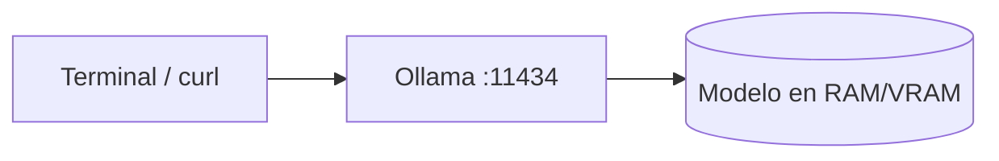

# Laboratorio 1 · Modelo local con Ollama

**Estado de validación:** el proveedor `OllamaProvider` está probado con respuestas simuladas (`backend/tests/test_ollama_provider.py`). **No se midió con un Ollama real**; sus números dependerán de su equipo.

## 1. Objetivo y competencias
Ejecutar un modelo open-weight en su máquina, observar sus métricas (tokens/s, tiempo al primer token) y entender por qué «gratis» no significa «sin costo» (energía, hardware, su tiempo).

## 2. Arquitectura


## 3. Prerrequisitos
Ubuntu 24.04+ (o WSL2), 8 GB de RAM libres como mínimo para el modelo pequeño sugerido, 3 GB de disco.

## 4. Hardware y software
CPU es suficiente para `llama3.2:1b` (lento pero funcional). GPU NVIDIA acelera mucho; no es obligatoria.

## 5. Configuración
```bash
curl -fsSL https://ollama.com/install.sh | sh     # instalador oficial; revíselo antes si su política lo exige
ollama --version
```

## 6–8. Procedimiento
```bash
ollama pull llama3.2:1b
ollama run llama3.2:1b "Explica en dos frases qué es FinOps."
curl -s http://localhost:11434/api/chat -d '{"model":"llama3.2:1b","stream":false,
 "messages":[{"role":"user","content":"Di hola en una frase."}]}' | python3 -m json.tool
```

## 9. Resultado esperado
Una respuesta de texto y, en el JSON, los campos `eval_count`, `eval_duration`, `prompt_eval_duration` y `total_duration` (**en nanosegundos**).

## 10. Validación
Calcule: `tokens/s = eval_count / (eval_duration / 1e9)`. Anote el valor: lo usará en los laboratorios 3 y 4 (`--tps`).

## 11. Métricas
tokens/s de salida, tiempo de carga del modelo (primera llamada, más lenta), uso de RAM (`free -h`).

## 12. Seguridad
Ollama escucha en `127.0.0.1` por defecto: **no lo exponga a Internet** ni cambie `OLLAMA_HOST=0.0.0.0` sin un proxy con autenticación (no trae autenticación propia). Descargue modelos solo de fuentes que reconozca (cadena de suministro, OWASP LLM04).

## 13. Costos
Sin cargo de nube. Costo real: electricidad y desgaste de su equipo.

## 14. Problemas frecuentes
- `connection refused`: el servicio no corre → `systemctl status ollama` o `ollama serve`.
- Muy lento o «out of memory»: use un modelo más pequeño o cierre aplicaciones.

## 15. Limpieza
`ollama rm llama3.2:1b` libera el disco.

## 16. Reflexión
¿Qué cambia entre medir tokens/s con un solo usuario y con 100 simultáneos? ¿Qué parte del costo de este laboratorio no aparece en ninguna factura?
