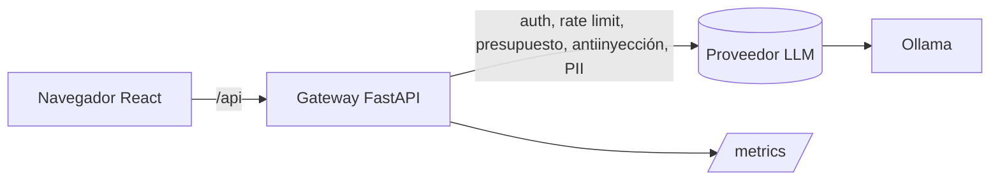

# Laboratorio 2 · Gateway FastAPI + tablero React

**Estado:** 33 pruebas del backend y 4 del frontend pasan; compilación del front correcta. **Docker Compose: escrito pero no probado** en el entorno de preparación (el demonio no se ejecutó ahí). El arranque con `uvicorn --factory` sí se comprobó.

## 1. Objetivo y competencias
Poner un punto único de entrada delante del modelo para aplicar autenticación, límites, presupuesto, filtrado y medición de costo (patrón *gateway*, ver `docs/01-arquitecturas-y-patrones.md`).

## 2. Arquitectura


## 3–4. Prerrequisitos y requisitos
Laboratorio 1 completo; Python 3.12; Node 22.

## 5. Configuración
```bash
cd ..                       # raíz del repositorio
make setup
cp .env.example .env
```

## 6–8. Procedimiento
Terminal 1: `make run-backend`  ·  Terminal 2: `make run-frontend` → abra http://localhost:5173
```bash
curl -s localhost:8000/health
curl -s localhost:8000/v1/chat -H 'Content-Type: application/json' \
  -d '{"messages":[{"role":"user","content":"¿Qué es un reserved instance?"}]}'
curl -s localhost:8000/v1/budget
```
Con Docker (opcional): `docker compose up -d --build && make pull-model`.

## 9. Resultado esperado
`/health` devuelve `ok` si Ollama responde y `degraded` si no. `/v1/chat` devuelve texto más un bloque de costos (costo sombra de API y costo de cómputo propio).

## 10. Validación
`make test-backend` → 33 pruebas. Con `GATEWAY_API_KEYS=abc` y sin cabecera de clave, `/v1/chat` debe responder 401.

## 11. Métricas
`/metrics` (formato Prometheus): solicitudes, errores, tokens, costo acumulado.

## 12. Seguridad
Con `ENVIRONMENT` distinto de `dev` el gateway **se niega a arrancar sin claves** (falla cerrado). No se registran prompts salvo `LOG_PROMPTS=true`. Puertos enlazados a `127.0.0.1` en Compose.

## 13. Costos
Cero en nube. `INFRA_COST_PER_HOUR_USD` permite simular el costo de una VM/GPU.

## 14. Problemas
- `degraded`: Ollama no corre o `OLLAMA_BASE_URL` es incorrecto.
- Aviso de `httpx` en las pruebas: inofensivo (Starlette cambió su cliente de pruebas).

## 15. Limpieza
`docker compose down -v` · `rm -rf .venv frontend/node_modules`

## 16. Reflexión
¿Por qué el gateway descarta los mensajes `system` enviados por el cliente? ¿Qué pasaría con la factura si no existiera el límite por cliente?
