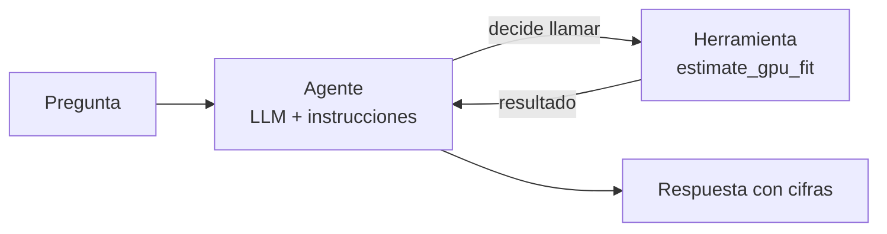

# Agentes en la nube: consola + código (Google Cloud · Azure · AWS)

## ¿Qué es esta carpeta y por qué existe?
La sesión trata de **optimizar** servicios de LLM. Pero en la práctica empresarial muchos equipos no despliegan el modelo ellos mismos:
usan **plataformas administradas** que ofrecen *agentes* (un LLM + instrucciones + herramientas). Aquí ve **el mismo agente sencillo**
construido de dos formas en cada nube:

| Parte | Qué es | Para qué |
|---|---|---|
| **1 · Consola** | Crear el agente con clics, sin código | Entender qué ofrece la plataforma y probarla en minutos |
| **2 · Código** | Crear el agente con el SDK/framework del proveedor | Versionarlo, probarlo y desplegarlo como software |
| **3 · Mapa** | Dónde está cada ejemplo | Ver en `MAPA_EJEMPLOS.md` |

## El agente de ejemplo: "Asesor de capacidad"
Responde preguntas como *"¿Cabe Llama 3.1 8B en una GPU de 24 GB con 8 conversaciones de 8 192 tokens?"*.
Tiene **dos herramientas** (`estimate_gpu_fit`, `list_supported_models`) que calculan memoria con la misma fórmula del Lab 3b.
Así **todas las implementaciones hacen lo mismo** y usted compara los *frameworks*, no la lógica.



Respuesta correcta esperada (verificada en `tests/test_shared_tools.py`): en 24 GB, 8 conversaciones de 8 192 tokens **no caben en FP16 (≈ 24.5 GB)** pero **sí en Q8_0 (≈ 17.5 GB)**.

## Estructura
```
cloud_agents/
├── shared/capacity_tools.py     ← fuente única de las herramientas
├── gcp/                         ← README (consola) + adk_agent/ (código)
├── azure/                       ← README (consola) + 4 frameworks
├── aws/                         ← README (consola) + Strands/AgentCore + boto3
├── managed_latency/             ← mide TTFT en los modelos administrados de cada nube
└── tests/                       ← pruebas de las herramientas
```
`shared/capacity_tools.py` se **copia** a cada ejemplo (`make sync-tools`) para que cada carpeta se pueda desplegar sola; una prueba verifica que las copias estén sincronizadas.

## Estado de verificación (sea honesto con sus compañeros)
| Qué | Estado |
|---|---|
| Las herramientas calculan bien | ✅ Probado con `pytest` |
| Cada ejemplo importa y **construye** el agente con las versiones actuales de su SDK | ✅ Verificado (sin credenciales: no llama al modelo) |
| Ejecución **contra la nube real** (modelo, despliegue, consola) | ⏳ **Pendiente**: requiere sus cuentas. Cuando la ejecute, anote la fecha y la versión de cada SDK |
| Pasos de **consola** | Basados en documentación oficial; las interfaces cambian con frecuencia |

## Seguridad y costos (léalo antes de ejecutar)
- **Credenciales:** use identidad (az login, `gcloud auth application-default login`, SSO de AWS). **Nunca** escriba claves en el repositorio (`.gitignore` ya excluye `.env`).
- **Mínimo privilegio:** las herramientas son de solo lectura y sin red. Un agente que *ejecuta acciones* exige permisos mínimos y aprobación humana.
- **Costos:** cada despliegue en runtime administrado cobra. Use cuentas *trial*, configure alertas de presupuesto y **haga la limpieza** al terminar (cada README la incluye).
