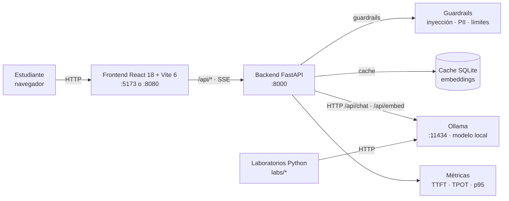
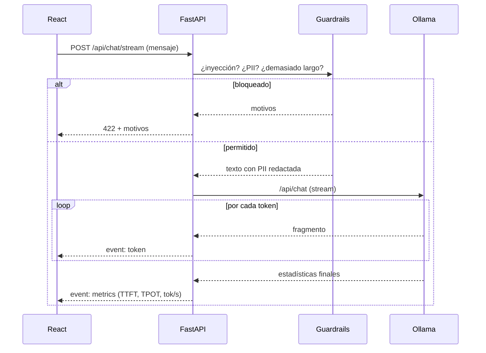

# Arquitectura de la solución de la sesión

Este documento explica **qué piezas tiene el repositorio y cómo se hablan entre sí**.

## Vista general (entorno local del curso)

**Cómo leerlo:** el usuario nunca habla directo con el modelo. Siempre pasa por el backend, que es el lugar donde se aplican la
seguridad, la cache y las métricas. Los laboratorios hablan directo con Ollama porque necesitan medir *el servidor de inferencia* sin intermediarios.

## Flujo de una petición de chat (streaming)

## Mapa a producción en la nube (conceptual)

El mismo diseño se traslada a cada proveedor sustituyendo componentes. Los nombres de servicios cambian con frecuencia:
**verifique siempre la documentación oficial vigente** (enlaces en `docs/06_referencias.md`).

| Capa | Local (curso) | Azure | Google Cloud | AWS |
|---|---|---|---|---|
| Frontend estático | nginx | Static Web Apps / Container Apps | Cloud Run / Cloud Storage + CDN | S3 + CloudFront |
| API / backend | FastAPI en Docker | Azure Container Apps / AKS | Cloud Run / GKE | ECS (Fargate) / EKS / Lambda |
| Inferencia administrada | — | Microsoft Foundry (Azure OpenAI y otros) | Vertex AI / Gemini Enterprise Agent Platform | Amazon Bedrock |
| Inferencia autogestionada | Ollama | vLLM en AKS con GPU | vLLM en GKE con GPU | vLLM en EKS con GPU |
| Agentes administrados | — | Foundry Agent Service | Vertex AI Agent Engine (hoy Agent Platform) | Bedrock Agents / AgentCore Runtime |
| Secretos | `.env` | Key Vault | Secret Manager | Secrets Manager |
| Identidad | API key | Microsoft Entra ID / Managed Identity | IAM / Workload Identity | IAM / roles |
| Observabilidad | logs JSON + `/metrics` | Azure Monitor / Application Insights | Cloud Monitoring / Trace | CloudWatch / X-Ray |
| Guardrails | heurísticas propias | Azure AI Content Safety / Prompt Shields | Model Armor | Bedrock Guardrails |

## Requerimientos que guían el diseño

**Funcionales:** chat con streaming; embeddings con cache; calculadora de capacidad; inspección de guardrails; métricas.

**No funcionales (con la meta que usaremos como ejemplo de clase):**

| Atributo | Objetivo de ejemplo | Cómo lo atiende este repositorio |
|---|---|---|
| Latencia | TTFT p95 ≤ 1 s, TPOT p95 ≤ 100 ms (*valores hipotéticos de clase*) | Streaming, `keep_alive`, medición p50/p95/p99 |
| Throughput | N conversaciones simultáneas | Batching del servidor (`OLLAMA_NUM_PARALLEL`), Lab 3 |
| Disponibilidad | 99,9 % (hipótesis del caso universitario) | Probes `/health` y `/ready`; diseño sin estado en el backend |
| Seguridad | OWASP LLM Top 10 | Guardrails, API key, rate limit, sin logs de prompts |
| Costo | Capacidad dimensionada, no sobredimensionada | Calculadora de memoria, cuantización, cache |

## Decisiones de arquitectura

Registradas como ADR en `docs/adr/`:

- [ADR-001](adr/ADR-001-ollama-para-laboratorio.md) — Ollama como motor de inferencia del laboratorio local.
- [ADR-002](adr/ADR-002-streaming-sse.md) — SSE (y no WebSockets) para el streaming de tokens.
- [ADR-003](adr/ADR-003-guardrails-en-capas.md) — Guardrails propios como *primera* capa, no como única.
