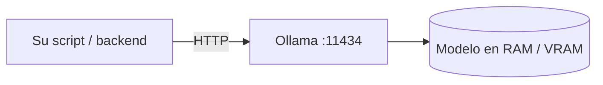

# Lab 1 · Ejecutar un LLM en su computador con Ollama

**Duración:** 20 min · **Nivel:** inicial · **Necesita:** Ubuntu 24.04 (o WSL2), 8 GB de RAM, conexión a Internet para descargar el modelo.

## ¿Qué aprenderá?
1. Qué es un *servidor de inferencia* y por qué es distinto de "una librería de IA".
2. Cargar un modelo, hablarle por la API HTTP y ver **cuánto tarda** (cold start vs respuesta con el modelo ya cargado).
3. Dos perillas de rendimiento: `OLLAMA_KEEP_ALIVE` y `OLLAMA_NUM_PARALLEL`.

## Idea central
Ollama es un programa que **carga el modelo en memoria una vez** y atiende peticiones HTTP en el puerto `11434`.
Todo lo que haremos en la sesión (backend, laboratorios, interfaz) *habla con ese servidor*.



## Paso a paso

**1. Instalar y descargar los modelos**
```bash
bash labs/lab01_ollama_local/install_and_pull.sh
```
Descarga `llama3.2:1b` (≈ 1.3 GB) y `nomic-embed-text` (para el Lab 5).

**2. Primera conversación**
```bash
ollama run llama3.2:1b "Explica en dos frases qué es un LLM"
```

**3. Probar la API**
```bash
bash labs/lab01_ollama_local/smoke_test.sh
```
Observe el paso 4 (`/api/ps`): muestra qué modelos están en memoria y cuánto de cada uno está en **GPU** (`size_vram`) frente al tamaño total (`size`).

**4. Sentir el *cold start***
```bash
curl -s localhost:11434/api/generate -d '{"model":"llama3.2:1b","keep_alive":0}' >/dev/null   # descarga el modelo
time ollama run llama3.2:1b "Hola"        # primera petición: incluye carga
time ollama run llama3.2:1b "Hola otra vez"   # segunda: el modelo ya está cargado
```
**Pregunta:** ¿cuánto del tiempo de la primera petición fue *cargar* el modelo? (El campo `load_duration` de la API lo dice exactamente: lo medirá en el Lab 2.)

**5. (Opcional) Habilitar paralelismo**
```bash
sudo bash labs/lab01_ollama_local/configure_parallel.sh 4 10m
```
Esto es necesario para el Lab 3 (si lo deja en 1, las peticiones concurrentes se encolan).

## Resultado esperado
- `ollama run` responde en español.
- `smoke_test.sh` imprime versión, lista de modelos, una respuesta y el estado en memoria.

## Solución de problemas
| Problema | Solución |
|---|---|
| `connection refused` | `sudo systemctl start ollama` (o `ollama serve` en otra terminal) |
| Muy lento | Está usando CPU con un modelo grande: quédese con `llama3.2:1b` |
| No usa la GPU | Verifique `nvidia-smi`; revise los logs: `journalctl -u ollama -f` |

## Limpieza
```bash
ollama rm llama3.2:1b nomic-embed-text      # libera disco
```

## Preguntas de reflexión
1. ¿Por qué conviene que el modelo **permanezca cargado** entre peticiones? ¿Qué costo tiene mantenerlo (piense en memoria y en una nube cobrando por hora)?
2. ¿Qué riesgo de seguridad habría si expusiera el puerto 11434 a Internet?
